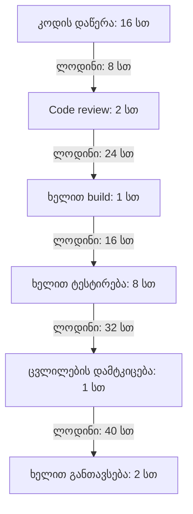

# Value Stream და DORA მეტრიკები

## 1. მიმდინარე პროცესი

ჯამური სამუშაო დრო:
16 + 2 + 1 + 8 + 1 + 2 = 30 საათი.

ჯამური ლოდინის დრო:
8 + 24 + 16 + 32 + 40 = 120 საათი.

სრული lead time:
30 + 120 = 150 სამუშაო საათი.

Flow efficiency:
სამუშაო დრო / სრული lead time × 100
= 30 / 150 × 100 = 20%.

ცვლილება სრული დროის 20%-ში მუშავდება, დანარჩენი 80% კი ლოდინია.

## 2. მთავარი bottleneck

ყველაზე დიდი დაყოვნება ცვლილების დამტკიცებასა და განთავსებას
შორისაა: 40 საათი.

ეს შეადგენს:
- სრული lead time-ის 40 / 150 × 100 ≈ 26.67%-ს;
- ჯამური ლოდინის 40 / 120 × 100 ≈ 33.33%-ს.

დამტკიცებას თვითონ მხოლოდ 1 საათი სჭირდება, მაგრამ შემდეგ
ცვლილება განთავსებამდე კიდევ 40 საათს ელოდება. შესაბამისად,
ამ მონაცემებით გაუმჯობესების მთავარი სამიზნე განთავსების რიგია.

## 3. Value Stream დიაგრამა

## 4. ორი ეტაპის გაუმჯობესება

### ტესტირება

პრაქტიკა: ავტომატური ტესტები CI pipeline-ში და შედეგების
ავტომატური მიწოდება ცვლილების დამმტკიცებლისთვის.
დამტკიცებისთვის განისაზღვროს მაქსიმუმ 4-საათიანი რეაგირების დრო.

- ტესტირების სამუშაო დრო: 8 → 2 საათი.
- ტესტირების შემდეგ ლოდინი: 32 → 4 საათი.

2 საათი მოიცავს დარჩენილ ხელით შემოწმებასა და შედეგების განხილვას.

### ცვლილების დამტკიცება და განთავსებაზე გადაცემა

პრაქტიკა: Continuous Delivery — დამტკიცების შემდეგ მომზადებული
რელიზი გადადის განთავსებაზე, ხანგრძლივი დაგეგმილი ფანჯრის
ლოდინის გარეშე.

- დამტკიცების სამუშაო დრო: რჩება 1 საათი.
- დამტკიცების შემდეგ ლოდინი: 40 → 4 საათი.

ამ გათვლაში თვითონ განთავსების 2-საათიანი სამუშაო დრო უცვლელია.

### განახლებული დროები

| ეტაპი | სამუშაო დრო (სთ) | ლოდინი შემდეგ ეტაპამდე (სთ) |
|---|---:|---:|
| კოდის დაწერა | 16 | 8 |
| Code review | 2 | 24 |
| ხელით build | 1 | 16 |
| ტესტირება CI-ის დახმარებით | 2 | 4 |
| ცვლილების დამტკიცება | 1 | 4 |
| განთავსება | 2 | 0 |
| **ჯამი** | **24** | **56** |

ახალი lead time:
24 + 56 = 80 სამუშაო საათი.

ახალი flow efficiency:
24 / 80 × 100 = 30%.

Lead time შემცირდა:
150 − 80 = 70 საათით, ანუ დაახლოებით 46.67%-ით.

Flow efficiency გაიზარდა 20%-დან 30%-მდე — 10 პროცენტული პუნქტით.

## 5. DORA მეტრიკები

### Deployment Frequency — განთავსების სიხშირე

4 კვირაში დაფიქსირდა 8 განთავსება.

8 / 4 = 2 განთავსება კვირაში.

### Lead Time for Changes — ცვლილების მიწოდების დრო

Commit-იდან production-მდე დროები ზრდადობით:
6, 8, 12, 16, 24, 30, 30, 54 საათი.

ჩანაწერების რაოდენობა ლუწია, ამიტომ მედიანაა შუა ორი
მნიშვნელობის საშუალო:

(16 + 24) / 2 = 20 საათი.

ეს მაჩვენებელი დათვლილია განთავსებების ჟურნალიდან.
წინა სექციის 150 საათი კი სცენარის მთლიანი პროცესის დროა;
ისინი სხვადასხვა საწყის მონაცემს ეყრდნობა.

### Change Failure Rate — წარუმატებელი ცვლილებების წილი

8 განთავსებიდან 2 ჩავარდა.

2 / 8 × 100 = 25%.

### აღდგენის საშუალო დრო

ორი ჩავარდნის აღდგენას დასჭირდა 3 და 5 საათი.

(3 + 5) / 2 = 4 საათი.